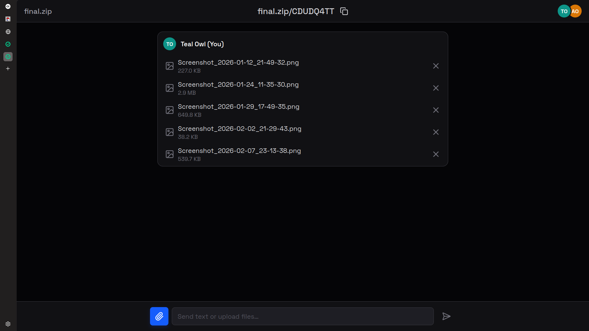

I cannot count the number of times that I've wanted to quickly transfer a file, and gotten hit with "File type not supported", "You don't have enough space", "The ile is too big" or simply just "Cannot upload file". I'd always sit there in a mix of awe and frustration, and wonder how it's so hard to just transfer a goddamn file without paying money or creating an account.

I channeled this frustration into a website called final.zip, that allows you to transfer a file P2P: No logins, no file size limits and no paywall. I don't store any of the files, which is how I can offer no size limits without drowning in hosting costs ($6).

[final.zip](https://final.zip/)

The name is inspired by the never-ending cycle of naming files 'final.zip',
